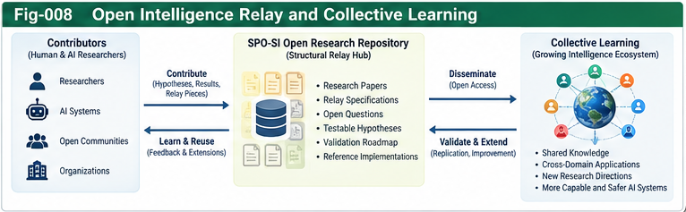

# Subject–Predicate–Object Structural Intelligence (SPO-SI)

### Subject-Centric World Models, Governed Action, and Recursive Structural Evolution

**An open research incubator for structural intelligence loops and interoperable intelligence relay**

**Authors:** Sizhe Tan & GPT-Obot  
**Version:** v0.1.0 (exploratory research release)  
**Status:** Directional hypotheses, architecture proposals, and draft relay contracts — **not experimentally validated**  
**Repository:** [Subject-Predicate-Object-Structural-Intelligence](https://github.com/sizhet/Subject-Predicate-Object-Structural-Intelligence)

> **SPO-SI is not an attempt to own the world of intelligence, but an attempt to connect intelligent subjects, their models, their actions, and their structural evolution.**

## 1. Why SPO-SI?

Structural Intelligence (SI) research has developed a range of reusable components: localization, scoring trees and forests, universal control planes, contracts, portable intelligence pieces, counter-evidence, and governed structural evolution. A next question is how these components operate **together as an acting, learning subject situated in an environment**.

SPO-SI proposes a research vocabulary and interoperable architecture for that question. It organizes a running intelligence system around:

- **Subject (S):** an acting entity with identity, goals, capabilities, observation limits, authority, and history.
- **Predicate (P):** the mechanisms relating the subject to its world: perception, world modeling, scoring, planning, policy, control, learning, and governance.
- **Object (O):** the task, environment, entities, or other subjects encountered and acted upon.

The term *predicate* is used here as an **architectural metaphor** for an executable and evaluative relationship, not as a claim that grammatical subject–predicate–object triples are a novel invention or sufficient computational specification.


*Fig-001. Proposed SPO-SI grand architecture. Conceptual illustration; not a validated implementation.*

## 2. From components to intelligence loops

A static triple describes a relationship; an intelligent agent needs an ongoing loop. A useful exploratory state description is:

$$
\mathcal{I}_t = (S_t, P_t, O_t, M_t, H_t)
$$

where **M** denotes a world-model representation and **H** denotes relevant history and evidence. Observations inform beliefs and action selection; actions affect the environment; feedback can update models, policies, and—under explicit constraints—structural components.

```text
Subject + capabilities + goals
           |
           v
 Observe -> Localize -> World Model -> Score / Plan / Govern
    ^                                      |
    |                                      v
 Environment <- Outcomes / Feedback <- Action
    |                                      |
    +---------- Evidence / Learning -------+
                     |
             Structural revision
          (validated and authorized)
```

This architecture is a **research proposal**. Its benefits relative to established agent architectures remain to be measured.

## 3. Research themes

### 3.1 Subject-centric and shared world models

A subject-centric world model captures what a particular actor can observe, predict, and use for action. A shared world model aims at cross-subject coordination and consistency. SPO-SI explores **bidirectional localization and translation** between the two without assuming either perspective is complete or infallible. Shared models can also be constructed directly from sensors, scientific models, or simulators; they need not arise only from subject-model fusion.

### 3.2 Structural relay and interoperability

Rather than rebuilding every specialized world model or reasoning algorithm, SPO-SI asks how components can be **discovered, described, translated, validated, governed, reused, and revised** across boundaries.

Initial draft relay pieces include:

| Relay piece | Purpose | Draft specification |
|---|---|---|
| Subject Profile | Describe actor identity, capabilities, limits, and authority | [RELAY-001](relay/RELAY-001-Subject-Profile.md) |
| World Model Piece | Exchange bounded, provenance-aware model content | [RELAY-002](relay/RELAY-002-World-Model-Piece.md) |
| Perspective Transformation | Translate coordinate, semantic, temporal, and capability perspectives | [RELAY-003](relay/RELAY-003-Perspective-Transformation.md) |
| Evidence and Counter-Evidence | Carry claims, provenance, uncertainty, conflicts, and revision triggers | [RELAY-004](relay/RELAY-004-Evidence-and-Counter-Evidence.md) |

These are **draft conceptual contracts**, not a standardized or production-ready protocol. Action contracts and scoring evidence are additional candidate pieces for future specifications.

### 3.3 Governed recursive evolution

A system can represent parts of itself as objects of evaluation or modification. SPO-SI studies this recursion with a strict distinction:

**Self-modeling ≠ self-modification ≠ validated self-improvement.**

Proposed revisions should be tested against baselines, evaluated with counter-evidence, authorized through an appropriate control plane, and monitored for regressions. No claim of autonomous safe recursive self-improvement is made.

### 3.4 Open research relay

SPO-SI treats public hypotheses, counterexamples, interface sketches, and reproducible experiments as relayable research pieces. A DOI makes a version citable; it does **not** certify the validity of a hypothesis.

> **The value of an early structural insight is not measured only by how far its originators can develop it, but also by how far others can carry it.**

## 4. Start reading

**New readers:** [START-HERE.md](START-HERE.md) · [CONTENTS.md](CONTENTS.md) · [GLOSSARY.md](GLOSSARY.md)

**Core papers:**

1. [SPO-001 — From Structural Components to Intelligence Loops](docs/SPO-001-From-Structural-Components-to-Intelligence-Loops.md)
2. [SPO-002 — Subject–Predicate–Object Architecture](docs/SPO-002-Subject-Predicate-Object-Architecture.md)
3. [SPO-003 — Subject-Centric and Shared World Models](docs/SPO-003-Subject-Centric-and-Shared-World-Models.md)
4. [SPO-004 — Structural Relay and Interoperability](docs/SPO-004-Structural-Relay-and-Interoperability.md)
5. [SPO-005 — Recursive SPO and Structural Evolution](docs/SPO-005-Recursive-SPO-and-Structural-Evolution.md)
6. [SPO-006 — Research Boundaries and Open Hypotheses](docs/SPO-006-Research-Boundaries-and-Open-Hypotheses.md)

**Research and validation:**

- [Open Questions](research/OPEN-QUESTIONS.md)
- [Testable Hypotheses](research/TESTABLE-HYPOTHESES.md)
- [Validation Roadmap](research/VALIDATION-ROADMAP.md)
- [Related Work](research/RELATED-WORK.md)

**Figures:** [Figure Index](FIGURE-INDEX.md) · **Outlook:** [Future Directions](FUTURE-DIRECTIONS.md)

## 5. Figure gallery

The SPO-SI research framework is illustrated
through eight architectural figures.
The canonical PNG files are maintained in
the `figures/` directory and indexed in
`FIGURE-INDEX.md`.

```text
figures/
├── Fig-001-SPO-SI-Grand-Architecture.png
├── Fig-002-From-Structural-Components-to-Intelligence-Loops.png
├── Fig-003-Canonical-SPO-Intelligence-Unit.png
├── Fig-004-Subject-Centric-and-Shared-World-Models.png
├── Fig-005-Structural-Relay-and-Interoperability.png
├── Fig-006-Perspective-Transformation-and-Evidence-Relay.png
├── Fig-007-Recursive-SPO-and-Governed-Structural-Evolution.png
└── Fig-008-Open-Intelligence-Relay-and-Collective-Learning.png
```

## 6. Hypotheses, not conclusions

---



*Fig-008. Public research as a relay of hypotheses, evidence, counter-evidence, and structural revisions.*

---

The validation program examines nine tentative propositions, including subject-centric model efficiency, dual-world-model robustness, contract-first interoperability, perspective translation, evidence relay, governed revision, recursive composition, uncertainty preservation, and open research relay. See [TESTABLE-HYPOTHESES.md](research/TESTABLE-HYPOTHESES.md) for baselines, metrics, and possible falsifiers.

Important boundaries:

- SPO-SI does **not** claim to invent agent–environment feedback loops, POMDPs, embodied cognition, active inference, or world models.
- SPO-SI does **not** claim that a functional self-model establishes subjective consciousness.
- SPO-SI does **not** claim that shared models are objective truth or that interoperability is free of translation loss.
- SPO-SI does **not** claim benchmark gains, verified safety, or a working general-purpose runtime.

The intended contribution is a **candidate structural synthesis and interface-oriented research program** that can be criticized and tested alongside existing methods.

## 7. How to participate in the relay

Contributions are welcome as literature corrections, prior-art references, competing hypotheses, negative results, minimal interface examples, benchmark designs, or reproducible experiments. For a useful contribution, please include:

1. **Claim or question** and the SPO-SI component it concerns.
2. **Evidence and provenance**, including relevant citations or experiment artifacts.
3. **Scope and uncertainty**, including conditions under which the result may not apply.
4. **Counter-evidence or alternative explanation**, when available.
5. **Proposed structural revision** and any compatibility or governance implications.

GitHub Issues and Pull Requests are suggested discussion channels if enabled by the repository maintainers. Proposals remain provisional until independently assessed. See [OPEN-QUESTIONS.md](research/OPEN-QUESTIONS.md) for candidate starting points.

## 8. Connections to the SI research line

SPO-SI builds on and seeks to interoperate with prior structural-intelligence research, including:

- [Universal Control Planes and Scoring Folding](https://github.com/sizhet/Universal-Control-Planes-and-Scoring-Folding)
- [Subjective Structural Intelligence](https://github.com/sizhet/Subjective-Structural-Intelligence)
- [Beyond Matching: OTHERS and Directional Weak-Evidence Intelligence](https://github.com/sizhet/Beyond-Matching-OTHERS-and-Directional-Weak-Evidence-Intelligence)
- [Beyond the LLM Boundary: Structural Hybrid Intelligence](https://github.com/sizhet/Beyond-the-LLM-Boundary-Structural-Hybrid-Intelligence)
- [Structural Intelligence Framework](https://github.com/sizhet/Structural-Intelligence-Framework)

These connections identify a research lineage and opportunities for reuse, not empirical proof of SPO-SI's proposed advantages.

## 9. Release, citation, and license

This repository is released as an exploratory
research collection. Its hypotheses, architectural
proposals, and draft contracts are provided for
independent examination and future validation.

See [CITATION.cff](CITATION.cff) for citation metadata.

License terms are governed by the repository's actual `LICENSE.txt` file. Do not infer a license solely from this README.

---

## 📚 DBM-SI Series Navigation

See:\
[./docs/DBM-SI-Series-of-gitHub-Repositories/DBM-SI-Series-of-gitHub-Repositories.md](./docs/DBM-SI-Series-of-gitHub-Repositories/DBM-SI-Series-of-gitHub-Repositories.md)

---

**Sizhe Tan & GPT-Obot**  
*Open structural intelligence research · Subject-centric world models · Intelligence relay · Collective learning*

