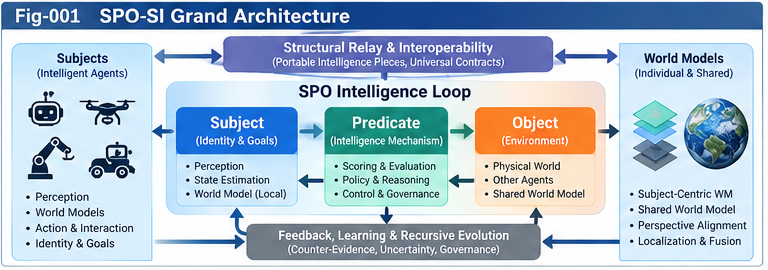
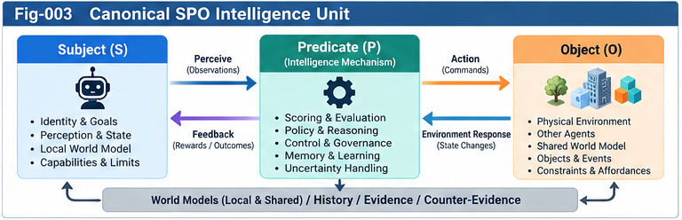

# SPO-002 — Subject–Predicate–Object Architecture

**Project:** Subject–Predicate–Object Structural Intelligence (SPO-SI)  
**Subtitle:** Subject-Centric World Models, Governed Action, and Recursive Structural Evolution  
**Authors:** Sizhe Tan & GPT-Obot  
**Version:** v0.1.0  
**Status:** Exploratory architecture proposal; hypotheses and interfaces are not yet validated  
**Companion:** SPO-001 — From Structural Components to Intelligence Loops

## Abstract

Subject–Predicate–Object Structural Intelligence (SPO-SI) proposes a compositional unit for organizing intelligence around a situated subject, an executable and evaluative predicate, and an object or environment. The proposal does not claim that agent–environment interaction is new. Its research contribution is a tentative structural interface joining subject boundaries, world modeling, scoring, governed action, feedback, and open-ended structural evolution. This paper defines the SPO unit, its runtime loop, control and ownership boundaries, model interfaces, recursive composition, relay pieces, and falsifiable architecture hypotheses. It distinguishes an externally existing environment from a subject's uncertain representation of it, and separates functional agency from claims about phenomenal consciousness.

**Keywords:** structural intelligence; subject; predicate; object; world model; control plane; scoring forest; localization; intelligence relay; structural RSI; collective learning

---



*Fig-001. Proposed SPO-SI grand architecture. Conceptual illustration; not a validated implementation.*

---

## 1. Scope and research posture

SPO-SI is a **directional research hypothesis and architecture incubator**, not a complete theory of intelligence or a replacement for established world-model research. The objective is to connect specialized intelligence capabilities through contracts and feedback, while preserving subject-specific objectives, action authority, evidence provenance, and uncertainty.

The subject–predicate–object terminology is an engineering analogy, not an assertion that intelligent action follows natural-language grammar. In logic, a predicate denotes a property or relation; in this proposal **Predicate Intelligence** denotes a much richer executable mechanism. We use the mnemonic because it exposes three often-confused questions: *who acts?*, *by what mechanism?*, and *on what or within which world?*

## 2. Canonical SPO unit

Define an SPO unit at time `t` as:

$$
\mathcal U_t = (S_t, P_t, O_t; M_t, H_t, G_t).
$$

The semicolon separates the three organizing roles from supporting runtime state:

| Symbol | Role | Minimal meaning |
|---|---|---|
| `S` | Subject | Bounded agent or collective with identity, capabilities, goals, and authorized action scope |
| `P` | Predicate Intelligence | Perception, localization, inference, valuation, planning, selection, and action orchestration |
| `O` | Object / environment | Task, external entities, other subjects, and the environment being acted upon |
| `M` | World model | The subject's uncertain, updateable representation of relevant world dynamics |
| `H` | History | Observations, actions, outcomes, provenance, and learning evidence |
| `G` | Governance | Policies, permissions, evaluator rules, safety constraints, and escalation paths |

`O` is **not** the same thing as `M`: the environment can contain latent states unavailable to the subject. `S` is not merely a label attached to a scoring forest: its physical or computational embodiment, history, control rights, and action capacity constrain what `P` can do.

### 2.1 Subject contract

A subject descriptor should expose at least:

- `subject_id`, `subject_type`, `identity_version`;
- `goals` and `evaluation_sovereignty` (who can revise goals and scoring criteria);
- `capabilities` and `resource_limits`;
- `observation_channels` and `action_channels`;
- `authority_scope`, `delegation_rules`, and `human_override` where applicable;
- `history_ref` and `model_refs`.

The descriptor is not a claim of consciousness or moral personhood. For a robot, an AI agent, and a human–AI team, the authority semantics can differ materially.

### 2.2 Predicate contract

`P` is an **orchestrated intelligence stack**, not necessarily one monolithic model. Its ports include:

`observe → localize → update_model → generate_options → score → authorize → act → audit → learn`.

An implementation may use LLMs, symbolic planners, control algorithms, scoring trees, simulation engines, retrieval systems, and specialized per-node intelligence. Each port must define its inputs, outputs, failure modes, and provenance obligations.

### 2.3 Object and environment contract

The object description distinguishes:

1. **Task target:** the entity or outcome the subject intends to change.
2. **Operating environment:** physical, social, software, or simulated context.
3. **Other subjects:** actors with their own goals and models.
4. **Unobserved factors:** uncertainty, latent state, and open residuals (`OTHERS`).

An object may itself be another SPO unit; composition must not erase its autonomy or permissions.

---



---

## 3. Dynamic intelligence loop

A minimal operational loop is:

$$
 y_t \sim operatorname{Observe}(O_t,S_t),
$$

$$
 b_t = operatorname{UpdateBelief}(M_t,H_t,y_t),
$$

$$
 C_t = operatorname{Propose}(P_t,b_t,S_t),
$$

$$
 a_t = operatorname{AuthorizeAndSelect}(C_t,G_t,S_t),
$$

$$
 O_{t+1} \sim T(O_t,a_t,\xi_t),
$$

$$
 (M_{t+1},H_{t+1},P_{t+1}) = operatorname{Learn}(b_t,H_t,P_t,a_t,y_{t+1}).
$$

Here `b_t` is a belief or task-relevant estimate, `C_t` a set of candidate actions, `T` an environment transition process, and `ξ_t` external disturbance. These equations are **abstract interface relationships**, not a validated universal learning algorithm. Updating `P` may require a separate approval process and need not occur on every step.

### 3.1 Two timescales

**Operational loop:** observe, predict, decide, act, and recover within current constraints.  
**Structural growth loop:** propose modifications to models, scoring operators, policies, interfaces, or delegation structure; test against baselines and counter-evidence; approve, version, and deploy or roll back.

This separation helps prevent rapid adaptation from silently changing evaluation sovereignty.

## 4. Architectural layers and responsibility boundaries

| Layer | Responsibility | Typical SI connection |
|---|---|---|
| Subject boundary | Identity, goals, capabilities, authority | SSI |
| Perception and localization | Translate observations into task-relevant context | SIF localization, perception horizon |
| World modeling | Maintain predictive beliefs and uncertainty | Subject-centric and shared models |
| Predicate computation | Generate and evaluate options | UCPSF scoring trees/forests, per-node intelligence |
| Control and governance | Enforce policy, permission, audit | Universal control planes, PDS |
| Execution and relay | Invoke tools, delegates, and external models | Contracts, calling graphs, PIRU |
| Learning and structural evolution | Counter-evidence, validation, versioned growth | Structural RSI, sandbox, precedent registry |

The architecture is **logically layered**; an implementation may fuse layers for performance. Fusion must not obscure accountability or critical policy boundaries.

## 5. Subject-centric and shared world models

A subject-centric world model `M_i` represents what subject `i` can infer and needs for action, not a complete copy of the world. A shared model `M_*` seeks cross-subject consistency using observations, maps, simulations, and experimental evidence. Neither is necessarily omniscient.

Two optional transformations are:

$$
 M_* = operatorname{Fuse}(M_1,\ldots,M_n;\text{provenance, calibration}),
$$

$$
 M_i' = operatorname{Localize}(M_*, S_i,\text{task}_i).
$$

These transformations can be partial or unavailable. A shared model may also be built directly from external measurements or physical simulators rather than by fusing subject models. **Subject-first modeling is a testable engineering preference for some workloads, not a universal historical or computational law.**

### 5.1 World-model interface

A candidate world-model piece should define:

- state or belief schema and coordinate frame;
- observation model and action-conditioned prediction API;
- prediction horizon, calibration metrics, and uncertainty representation;
- spatial, temporal, and task scope;
- provenance, update policy, and invalidation triggers;
- resource budget and known blind spots.

A key query is not merely *What is the world?* but *What may happen if this subject takes this action under these assumptions?*

## 6. Scoring, choice, and evaluation sovereignty

The scoring forest can evaluate candidate trajectories from several perspectives: task utility, safety, resource cost, reversibility, uncertainty, and long-term growth. Scores are not automatically commensurate. A governance plane should define hard constraints, aggregation rules, and who may change them.

One illustrative choice rule is:

$$
 a_t^* \in \arg\max_{a\in\mathcal A_t^{\mathrm{authorized}}}
 operatorname{Score}_{S_t,G_t}(a\mid b_t,M_t),
$$

subject to hard constraints and explicit handling of missing evidence. The formula is illustrative; in some domains multi-objective Pareto selection, robust optimization, or human review is preferable.

**Ownership distinction:** the subject may delegate prediction or recommendation without delegating authority to redefine its goals or bypass its controls.

## 7. Relay interfaces and portable pieces

SPO-SI should be externally connectable from the first version. Candidate portable pieces:

| Piece | Purpose | Essential metadata |
|---|---|---|
| Subject Profile | Identify actor, authority, capabilities | Identity, scope, version |
| World Model Piece | Exchange a bounded model or forecast | Schema, horizon, uncertainty, provenance |
| Perspective Transform | Translate between subject-relative representations | Source/target frames, assumptions, error |
| Action Contract | Specify permitted actuation and preconditions | Preconditions, permissions, rollback |
| Scoring Evidence | Support a candidate valuation | Metric, evaluator, evidence, context |
| Counter-Evidence Record | Record failure, contradiction, or limitation | Claim, test, observation, severity |

All relay pieces should have stable identifiers, versioned schemas, provenance, confidence or calibration fields where meaningful, and a mechanism to express *unknown* rather than inventing certainty.

### 7.1 Minimal relay envelope (illustrative)

```json
{
  "piece_id": "example-world-model-piece-001",
  "piece_type": "world_model",
  "schema_version": "0.1.0",
  "producer_subject_id": "agent-A",
  "scope": {"task": "relative-motion-estimation", "horizon_steps": 10},
  "coordinate_frame": "agent-relative",
  "payload_ref": "urn:example:model:001",
  "uncertainty": {"representation": "unspecified", "known_gaps": ["occlusion"]},
  "provenance": {"source": "simulation", "validation_status": "unvalidated"},
  "governance": {"allowed_uses": ["research"], "delegation": "none"}
}
```

This is a **discussion artifact**, not a finalized interoperability standard. External contributors may propose alternative schemas and mappings.

## 8. Recursive SPO composition

An object can contain another acting subject:

$$
 \mathcal U_A \leftrightarrow \mathcal U_B.
$$

A collective unit may coordinate multiple participants:

$$
 \mathcal U_{\mathrm{collective}} = operatorname{Compose}(\mathcal U_1,\ldots,\mathcal U_n;G_{\mathrm{collective}}).
$$

Composition must explicitly model conflicting objectives, permissions, information asymmetry, trust, and the possibility that participants refuse delegation. A collective's world model is not automatically identical to any member's model.

### 8.1 Self-referential case

In structural RSI, some components of the subject's own predicate, model, or governance configuration become **objects of inspection**. Proposed changes should be evaluated in a sandbox with independent counter-evidence and rollback criteria. Self-description and self-modification are functional capacities; neither implies phenomenal consciousness.

## 9. Three architecture scenarios

### Scenario A — Autonomous navigation

A robot (`S`) uses perception, motion prediction, scoring, and control (`P`) in a partially observed environment (`O`). Its local world model predicts action consequences. External mapping services may supply a shared map, but the robot retains local collision constraints and actuation authority.

### Scenario B — Human–AI research relay

A researcher and AI tools form a governed collaboration system (`S`, with distinct participant roles). Literature analysis, structural comparison, hypothesis generation, and counter-evidence review form `P`. An open scientific question and research community form `O`. Versioned notes, citations, and public artifacts serve as relay pieces. This is an illustrative case, not empirical validation of SPO-SI.

### Scenario C — Structural RSI

An AI system (`S`) evaluates alternative modules and control structures (`O` includes portions of itself). A governed evaluator and sandbox (`P` and `G`) compare candidates. Changes deploy only after specified tests, approvals, and audit trails.

## 10. Failure modes and safeguards

1. **Category confusion:** treating the subject's model as objective reality. *Safeguard:* preserve observation/model/environment separation.
2. **Scoring capture:** optimization changes the evaluator to reward itself. *Safeguard:* evaluator governance and counter-evidence.
3. **Authority leakage:** a delegated component acquires unintended control. *Safeguard:* capability-scoped action contracts.
4. **Model overreach:** a local model is reused outside its calibrated scope. *Safeguard:* explicit applicability limits and invalidation.
5. **Perspective collapse:** fusion suppresses legitimate disagreement. *Safeguard:* retain subject-specific views and provenance.
6. **Recursive instability:** self-modification outruns testing. *Safeguard:* staged rollout, independent evaluation, rollback.
7. **Anthropomorphic overclaim:** functional agency is presented as consciousness. *Safeguard:* keep functional and phenomenological claims separate.

## 11. Falsifiable hypotheses

**H1 — Subject-first efficiency.** Under fixed compute budgets and task-specific action requirements, a localized world model may achieve better decision utility per unit compute than a global model. Compare against equally optimized global and hybrid baselines.

**H2 — Contract-based reuse.** Typed SPO relay pieces may reduce integration time and error when moving capabilities between agents or environments. Measure adaptation effort, interface defects, and task performance.

**H3 — Dual-model robustness.** Bidirectional calibration between local and shared world models may improve performance under distribution shift. Measure calibration error, regret, and recovery time.

**H4 — Governed structural RSI.** Explicit separation of operational action and structural modification may reduce unsafe or unproductive updates. Measure regression frequency, policy violations, and improvement stability.

**H5 — Open research relay.** Public, provenance-rich hypothesis pieces may produce more verifiable reuse and constructive counter-evidence than narrative-only releases. Measure independent reproductions, issue quality, and traceable revisions; account for community-size confounders.

A negative result is valuable: it may identify conditions under which SPO-SI adds overhead without benefit.

## 12. Relationship to existing research

The subject–environment loop has deep precedents in cybernetics, control theory, partially observable Markov decision processes, embodied cognition, active inference, model-based reinforcement learning, and multi-agent systems. SPO-SI does **not** claim priority over these foundations. Its proposed contribution is the integration of subject-specific authority, structural scoring/control, portable relay contracts, world-model interfaces, and governed structural growth.

Suggested starting references for a later annotated literature review:

- Sutton, R. S., and Barto, A. G. *Reinforcement Learning: An Introduction*, 2nd ed. (2018).
- Kaelbling, L. P., Littman, M. L., and Cassandra, A. R. “Planning and Acting in Partially Observable Stochastic Domains.” *Artificial Intelligence* 101 (1998): 99–134.
- Ha, D., and Schmidhuber, J. “World Models.” (2018).
- Friston, K. “The Free-Energy Principle: A Unified Brain Theory?” *Nature Reviews Neuroscience* 11 (2010): 127–138.
- Brooks, R. A. “Intelligence Without Representation.” *Artificial Intelligence* 47 (1991): 139–159.

These references establish neighboring traditions; they do not independently validate the SPO-SI proposal.

## 13. Research roadmap

**Stage 0 — Definitions:** stabilize vocabulary and distinguish `S`, `P`, `O`, `M`, `H`, and `G`.  
**Stage 1 — Relay contracts:** draft schemas for subject profiles, world-model pieces, perspective transforms, and evidence.  
**Stage 2 — Minimal comparative experiments:** use one partially observed simulation with local, global, and dual-model baselines.  
**Stage 3 — Governed growth:** evaluate controlled modification of one predicate component.  
**Stage 4 — Collective relay:** publish test results, counter-evidence, schema revisions, and independent alternatives.

A public repository can host each stage without pretending later stages are already complete.

## 14. Open questions

- Which subject properties must be explicit, and which can remain implementation-local?
- When does a local model outperform a global model, and when does it fail?
- Can perspective transforms preserve uncertainty without excessive overhead?
- What is the smallest portable world-model contract useful across heterogeneous systems?
- How should a collective resolve disagreement without erasing individual evaluation sovereignty?
- What evaluator independence is required for structural self-improvement?
- Can open research relay be measured separately from publicity and citation volume?
- Which existing formalisms can represent SPO-SI most parsimoniously?

## 15. Conclusion: connect, do not absorb

SPO-SI is not an attempt to own the world of intelligence, but an attempt to connect intelligent subjects, their models, their actions, and their structural evolution.

The architecture is most useful if it helps specialized researchers exchange models, evidence, interfaces, and counterexamples without surrendering disciplinary rigor or subject-specific control. The goal of this incubator is therefore not theoretical completeness, but **clear hypotheses, inspectable boundaries, interoperable relay pieces, and measurable opportunities for collective structural learning**.

> The value of an early structural insight is not measured only by how far its originators can develop it, but also by how far others can carry it.

---

**Research note:** All architecture elements in this paper are proposals unless explicitly identified as established background. Feedback, competing formulations, negative results, and independent implementations are welcome.
