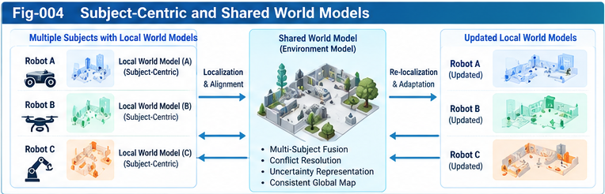

# SPO-003 — Subject-Centric and Shared World Models

**Project:** Subject–Predicate–Object Structural Intelligence (SPO-SI)  
**Subtitle:** Subject-Centric World Models, Governed Action, and Recursive Structural Evolution  
**Authors:** Sizhe Tan & GPT-Obot  
**Version:** v0.1.0  
**Status:** Open Research Incubator — Directional Hypotheses and Architecture Notes  
**Date:** 2026-10-26

> **Research position.** SPO-SI is not an attempt to own the world of intelligence, but an attempt to connect intelligent subjects, their models, their actions, and their structural evolution.

## Abstract

World models are often discussed as representations of an environment, but an acting subject rarely needs—or can afford—a complete representation of that environment. It needs a model conditioned on its sensors, embodiment, goals, actions, uncertainty, and history. Meanwhile, collaboration, scientific measurement, and multi-agent coordination benefit from shared models that reconcile observations across subjects. This note proposes a **dual-world-model** research architecture for Subject–Predicate–Object Structural Intelligence (SPO-SI): a **Subject-Centric World Model (SWM)** for local action and a **Shared World Model (ShWM)** for cross-subject alignment, prediction, and coordination. The architecture connects these layers through localization, perspective transformation, portable relay pieces, provenance, counter-evidence, and governed updates. It does not assume that a shared model is omniscient, that biological adaptation proves explicit world modeling, or that functional agency establishes subjective consciousness. We state interfaces, failure modes, testable hypotheses, and an incremental validation roadmap. The contribution is an integration hypothesis rather than a demonstrated general world-model algorithm.

**Keywords:** structural intelligence; subject-centric world model; shared world model; SPO-SI; perspective transformation; localization; uncertainty; intelligence relay; model-based control; collective learning; counter-evidence.

---



---

## 1. Motivation: From World Description to World Interaction

A model of the world can serve many purposes: forecasting, simulation, explanation, scientific measurement, coordination, or action selection. These purposes demand different representations and resolutions. A weather simulator, a robotic manipulation model, and a pilot's tactical situational model need not encode the same variables even when they refer to a common physical environment.

For SPO-SI, the foundational question is not only **“What is the world?”** but also **“What can this subject observe, predict, change, and learn in this world?”** The answer depends on the subject's boundary, sensors, actuators, goals, authority, available computation, and accumulated evidence.

This suggests two complementary model roles:

1. **SWM:** a subject-relative, action-oriented, resource-bounded model.
2. **ShWM:** a cross-subject model designed for coordination, interoperability, broader prediction, or validation.

Neither role implies a particular implementation. A model may be symbolic, probabilistic, geometric, neural, physics-based, language-mediated, or hybrid. Both roles may coexist in a single system, and a central world model may also be constructed directly from external instrumentation rather than synthesized from agents.

### 1.1 Scope and epistemic status

The subject/environment loop and partial observability are well-established research themes. SPO-SI's proposed contribution is a **structural integration layer** linking world modeling with subject boundaries, universal control planes, scoring forests, portable intelligence pieces, counter-evidence, and open-ended structural growth. Its benefits remain hypotheses requiring comparative experiments.

## 2. The SPO Setting

Let an SPO intelligence loop at time \(t\) be represented as

\[
\mathcal{I}_t = (S_t, P_t, O_t, M_t, H_t, G_t),
\]

where:

- \(S_t\): subject identity, capabilities, sensor and action boundaries;
- \(P_t\): predicate intelligence—perception, scoring, planning, policy, and execution mechanisms;
- \(O_t\): external objects, other subjects, tasks, and environment;
- \(M_t\): the subject's current world-model state;
- \(H_t\): observation, action, feedback, and evidence history;
- \(G_t\): governance constraints, authority, and permitted adaptation.

The subject receives observations \(y_t\), forms or updates a belief \(b_t\), selects a permitted action \(a_t\), and observes consequences:

\[
 y_t \sim p(y_t \mid x_t, S_t), \qquad
 b_t = \operatorname{Update}(b_{t-1}, a_{t-1}, y_t),
\]

\[
 a_t = \operatorname{GovernedPolicy}(b_t, P_t, G_t), \qquad
 x_{t+1} \sim p(x_{t+1}\mid x_t,a_t).
\]

Here \(x_t\) is an analytical environment state, not necessarily a state that any subject can directly access. This distinction prevents the mistaken identification of a simulator's full state with the agent's own knowledge.

## 3. Subject-Centric World Model (SWM)

An SWM is a model **for a subject's situated decisions**. Its content is selected and updated according to what the subject can sense, what it can do, and what it must decide.

### 3.1 Subject-relative representation

An SWM should explicitly carry:

- **Subject frame:** identity, embodiment, role, authority, and perspective;
- **Observation frame:** sensors, measurement reliability, latency, blind spots;
- **Action frame:** actuators, available tools, reachable outcomes, costs;
- **Task frame:** objectives, constraints, risk tolerances, time horizon;
- **Belief frame:** estimated states, hypotheses, confidence, unknowns;
- **Historical frame:** prior actions, outcomes, precedents, and counter-evidence.

A useful abstract transition is

\[
 b^{(i)}_{t+1} = F_i\big(b^{(i)}_t, a^{(i)}_t, y^{(i)}_{t+1};\theta_i\big),
\]

where \(i\) identifies the subject and \(\theta_i\) denotes its modeling assumptions. The superscript matters: two subjects may construct different but rationally useful models of the same situation.

### 3.2 Why selective modeling matters

For an autonomous aircraft in a tactical encounter, relative motion, fuel, maneuverability, sensor uncertainty, and safety constraints can be more decision-relevant than a high-fidelity model of the entire theater. For a software agent repairing a repository, relevant state may include failing tests, dependency constraints, file ownership, and recent edits—not the full contents of every accessible system.

The design principle is **perspective-aware computational allocation**: invest modeling resources where additional fidelity is expected to change decisions. This principle can be implemented through scoring forests, attention policies, adaptive resolution, or other mechanisms; it is not exclusive to SPO-SI.

### 3.3 Unknowns must remain representable

A subject-centric model is necessarily incomplete. The SWM must distinguish:

- observed facts;
- inferred or predicted states;
- alternative hypotheses;
- out-of-distribution conditions;
- unknown or unmatched evidence (**OTHERS**);
- disputed evidence and known counterexamples.

Forcing every observation into a closed ontology can create false certainty. An open evidence space should preserve unmatched signals until they can be assessed, classified, or rejected.

## 4. Shared World Model (ShWM)

A Shared World Model is an environment representation that supports multiple subjects or external observers. It may integrate sensor streams, coordinate systems, experiments, maps, physical constraints, simulation results, and independently obtained evidence.

A ShWM aims for **cross-perspective compatibility**, not absolute objectivity. Its claims must remain conditional on measurement quality, modeling assumptions, coverage, and time.

### 4.1 Three legitimate origins

A shared model may be built through:

1. **Multi-subject fusion:** reconcile several local models or observations.
2. **External instrumentation:** derive a model from sensors or scientific measurement independent of the agents using it.
3. **Hybrid construction:** combine local observations, instrumentation, prior knowledge, and simulation.

Thus, the hypothesis that objective-seeming models can emerge from coordinated subject perspectives is useful but **not a universal historical or engineering necessity**.

### 4.2 Governance and disagreement

The shared model must not silently override local observations or the subject's permitted decisions. Conflicts can indicate faulty sensors, time misalignment, different coordinate frames, legitimate contextual differences, or real model failure. A ShWM should preserve disagreement and its provenance until adjudicated.

## 5. Dual-World-Model Architecture

The central proposal is a **bidirectional relationship**:

\[
 \mathrm{SWM}_i \xrightarrow{\text{Relay / Alignment / Validation}} \mathrm{ShWM}
\]

\[
 \mathrm{ShWM} \xrightarrow{\text{Localization / Relevance Filtering}} \mathrm{SWM}'_i.
\]

The first direction contributes local evidence and hypotheses to a broader model. The second direction returns validated shared knowledge tailored to a subject's context, objectives, permissions, and computational budget.

### 5.1 Forward path: local to shared

1. Capture observation and action-outcome evidence.
2. Attach subject identity, time, coordinate frame, confidence, and provenance.
3. Transform into an interoperable representation when possible.
4. Detect duplicates, contradictions, and missing assumptions.
5. Fuse or register evidence without erasing unresolved differences.
6. Update shared hypotheses under an explicit validation policy.

### 5.2 Return path: shared to local

1. Identify the subject's active task and decision horizon.
2. Retrieve relevant shared structures or predictions.
3. Transform into the subject's observation and action frame.
4. Apply authority, privacy, safety, and resource constraints.
5. Merge with local evidence, retaining provenance and uncertainty.
6. Evaluate whether the update improves decisions or predictions.

### 5.3 Control-plane separation

A control plane decides **what may be imported, trusted, scored, executed, or changed**. It should remain distinct from the raw world-model data plane. A high-confidence prediction does not itself authorize an action; a shared model does not automatically acquire scoring sovereignty over a subject.

## 6. Perspective Transformation as a First-Class Operation

Two models may disagree merely because they use different frames or abstractions. A transformation should describe:

\[
 T_{i\rightarrow j}: (M_i, C_i) \mapsto (\widehat{M}_j, U_{i\rightarrow j}),
\]

where \(C_i\) is context and \(U_{i\rightarrow j}\) records uncertainty or information loss. Transformations may cover spatial coordinates, temporal resolution, ontology, units, goal relevance, and authority.

A transformation is **not guaranteed to be invertible**. For example, a compressed tactical summary cannot necessarily reconstruct raw sensor data. This links perspective transformation to uncertainty-aware folding and unfolding: missing information should be represented as missing, not fabricated.

### 6.1 Interoperability conditions

At minimum, each transformation should specify:

- source and target model versions;
- subject and task context;
- coordinate or semantic mappings;
- supported and unsupported fields;
- information-loss description;
- validation status and test cases.

## 7. Structural Relay Pieces: An Initial Interface Sketch

The following pieces are **research candidates**, not standardized APIs.

| Piece | Purpose | Minimum conceptual fields |
|---|---|---|
| Subject Profile | Establish whose perspective applies | subject ID, capabilities, sensor/action boundary, authority |
| World Model Piece | Exchange partial environmental knowledge | scope, variables, assumptions, timestamp, uncertainty |
| Perspective Transform | Map representations across frames | source/target, mapping, loss, validation |
| Action Contract | Bind prediction to permitted action | preconditions, effects, constraints, authorization |
| Scoring Evidence | Explain a valuation or prediction | criteria, evidence, score semantics, provenance |
| Counter-Evidence Record | Preserve contradictions and failures | challenged claim, observation, context, status |

### 7.1 Example: conceptual World Model Piece

```yaml
piece_type: world_model_piece
schema_version: "0.1-draft"
subject_id: "agent-A"
model_id: "local-encounter-model"
observed_at: "2026-10-19T10:00:00Z"
frame: "subject-relative"
scope: "relative motion of a tracked object"
claims:
  - variable: "relative_range"
    value: 1200
    unit: "m"
    status: "estimated"
    uncertainty: "illustrative: +/- 100 m"
provenance:
  source: "illustrative sensor fusion"
  validation: "unvalidated example"
unknowns:
  - "target intent"
authority:
  permitted_use: "simulation-only"
```

This is a documentation example only; it does not define a production schema or imply operational validity. Real implementations require typed uncertainty, time synchronization, access controls, and semantic validation.

## 8. How SPO-SI Connects to the Existing SI Framework

SPO-SI can reuse concepts already developed in related Structural Intelligence research:

- **SSI:** subject boundary, embodied capabilities, identity, self-model, and evaluation sovereignty;
- **UCPSF:** universal control planes, scoring forests, perspective-aware optimization, folding;
- **SIF:** perception, localization, per-node intelligence, contracts, precedent registry, governance;
- **BM-ODWEI:** unmatched evidence, directional weak-evidence scoring, counter-evidence provenance;
- **PIRP/PIRU:** portable intelligence pieces and relay localization;
- **Structural RSI:** governed model and policy revision, sandbox evaluation, rollback.

These connections are **proposed integration points**, not proof that a single formalism already subsumes the external world-model literature. The architecture should support independent specialist models instead of requiring all intelligence to be implemented in one language model.

## 9. Case Studies for Architecture Exploration

### 9.1 Autonomous agent in a changing environment

An agent uses its SWM to predict immediate action consequences. A shared map provides broader context. Local sensor evidence challenges a stale shared obstacle map. The relay records the discrepancy, validates it, and distributes a corrected region-specific update. Evaluation compares safety, response latency, and model calibration against local-only and shared-only baselines.

### 9.2 Multi-agent software maintenance

Several agents work on a repository. Each has a local model of its assigned module, dependencies, and failing tests. A shared model maintains cross-module contracts and build state. Relay pieces carry reproducible evidence, not only natural-language conclusions. Conflicting edits are resolved using provenance and explicit authority rules.

### 9.3 Recursive structural improvement

An agent proposes replacing a planning branch after observing failures. Its current model of its own behavior becomes part of the object of evaluation. The change is tested in a sandbox, compared against a baseline, and accepted only under an authorized policy. Self-modeling here is functional; it is **not evidence of subjective consciousness**.

## 10. Failure Modes and Counter-Evidence

A dual-model system may perform worse than a simpler baseline. Critical failure modes include:

1. **False consensus:** fusion suppresses minority but correct observations.
2. **Perspective leakage:** a shared model imposes another subject's goals or scoring criteria.
3. **Stale synchronization:** local action relies on delayed global state.
4. **Frame mismatch:** coordinates, units, ontologies, or timestamps are misaligned.
5. **Confidence laundering:** uncertain local claims appear certain after aggregation.
6. **Model overreach:** unnecessary global fidelity consumes resources without improving decisions.
7. **Unsafe adaptation:** structural updates bypass evaluation or authorization.
8. **Privacy and security failures:** relay exposes sensitive observations or enables malicious model poisoning.

Mitigations should include source provenance, bounded trust, explicit uncertainty, contradiction registers, sandbox tests, versioned contracts, and rollback mechanisms. These controls must themselves be tested.

## 11. Testable Hypotheses

**H1 — Subject-First Efficiency.** Under constrained computation and time-sensitive decisions, a task-relevant SWM can outperform an equally budgeted broad environmental model on decision utility. **Falsifier:** no improvement or worse performance across well-controlled tasks.

**H2 — Dual-Model Robustness.** Bidirectional SWM–ShWM exchange improves robustness or calibration over local-only and shared-only models under partial observability. **Falsifier:** systematic degradation after accounting for communication cost and latency.

**H3 — Relay Reuse.** Typed, provenance-aware relay pieces reduce integration effort and representation errors compared with ad hoc text-only exchanges. **Falsifier:** no measurable gains across heterogeneous model implementations.

**H4 — Uncertainty Preservation.** Explicit unknowns, counter-evidence, and transformation loss reduce overconfident decisions. **Falsifier:** no calibration or risk benefit, or unacceptable cost.

**H5 — Governed Structural Growth.** Sandboxed and authorized model/policy updates improve longitudinal performance without increasing unsafe regressions relative to unguided adaptation. **Falsifier:** persistent performance or safety regressions.

These hypotheses should be preregistered or at least specified before evaluation where feasible.

## 12. Validation Roadmap

### Phase A — Formalize interfaces

Define typed subject profiles, model pieces, transformation contracts, uncertainty semantics, and evidence provenance. Publish examples and negative cases.

### Phase B — Small controlled environments

Use a partially observable grid world or simulated navigation task with identical compute budgets. Compare local-only, shared-only, and dual-model agents. Measure task success, regret, latency, calibration, communication volume, and failure recovery.

### Phase C — Heterogeneous relay

Connect symbolic, probabilistic, and learned models through relay pieces. Test semantic compatibility, transformation loss, and contradiction handling.

### Phase D — Multi-agent and structural adaptation

Add conflicting observations, changing environments, adversarial inputs, and sandboxed policy updates. Track longitudinal gains and regressions.

### Phase E — External replication

Release schemas, datasets or simulator settings where licensing permits, test protocols, and negative results. Invite independent implementations and comparisons.

## 13. Relationship to Established Research

The proposal should be read alongside—not as a replacement for—established work on partially observable Markov decision processes (POMDPs), Bayesian state estimation, model-based reinforcement learning, predictive processing, active inference, embodied cognition, multi-agent belief modeling, sensor fusion, and model predictive control. Relevant starting points include:

- Kaelbling, Littman, and Cassandra (1998), *Planning and Acting in Partially Observable Stochastic Domains*, Artificial Intelligence.
- Ha and Schmidhuber (2018), *World Models*, arXiv:1803.10122.
- Hafner et al. (2023), *Mastering Diverse Domains through World Models*, arXiv:2301.04104.
- Friston (2010), *The Free-Energy Principle: A Unified Brain Theory?*, Nature Reviews Neuroscience.
- Oliehoek and Amato (2016), *A Concise Introduction to Decentralized POMDPs*, Springer.

These references are contextual entry points, not claims that the cited authors endorse SPO-SI. A future `RELATED-WORK.md` should systematically compare assumptions, algorithms, evaluation settings, and novelty claims.

## 14. Open Questions

1. When does a task-relative SWM become too narrow to support safe decisions?
2. How should a subject choose the boundary between local and shared knowledge?
3. Can perspective transformations preserve useful uncertainty under severe compression?
4. How can a shared model represent irreducible disagreement without forcing consensus?
5. Which governance rights remain with each subject when models are collectively trained or updated?
6. What are the smallest useful relay pieces across neural, symbolic, and physical models?
7. Can structural folding yield compact, recoverable task models without hiding decisive evidence?
8. How should a system distinguish model error from changing environmental dynamics?
9. How can we prevent a high-quality shared prediction from becoming unauthorized action control?
10. Which measurable advantages, if any, are unique to the SPO-SI integration rather than existing agent architectures?

## 15. Open Research and Collective Learning

**SPO-SI is a research relay, not a claim of ownership over world-model research.** The objective is to make structural insights legible and reusable by specialists who may know more about particular models, environments, or experiments. Contributions may include counterexamples, competing architectures, new relay pieces, validation data, implementation reports, and negative results.

> **The value of an early structural insight is not measured only by how far its originators can develop it, but also by how far others can carry it.**

A useful relay must communicate not only conclusions but also assumptions, uncertainties, interfaces, failure cases, and paths to verification. We therefore encourage explicit differentiation among **established results**, **proposed designs**, and **unvalidated hypotheses**.

## 16. Conclusion

Subject-centric and shared world models solve different but complementary problems. The former prioritizes actionable, resource-bounded understanding from a particular subject's perspective; the latter supports coordination, cross-perspective reconciliation, and broader environmental prediction. Their interaction can be organized through structural relay, localization, perspective transformation, provenance, counter-evidence, and governed control. SPO-SI proposes this architecture as a testable integration hypothesis, not a finished universal model.

The central research question is whether such an architecture can make world models **more interoperable, composable, governable, and evolvable** without sacrificing the strengths of specialized modeling methods.

---

### Suggested repository cross-links

- `SPO-001-From-Structural-Components-to-Intelligence-Loops.md` — conceptual motivation and intelligence loops.
- `SPO-002-Subject-Predicate-Object-Architecture.md` — canonical SPO structure and governance.
- `SPO-004-Structural-Relay-and-Interoperability.md` — proposed relay interfaces and contracts.
- `research/TESTABLE-HYPOTHESES.md` — experimental criteria and baselines.
- `research/RELATED-WORK.md` — comparisons with established world-model research.

**License:** Refer to the repository's `LICENSEE.txt` file.  
**Citation:** Refer to the repository's `CITATION.cff` when available.
