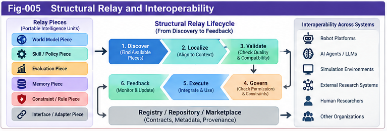
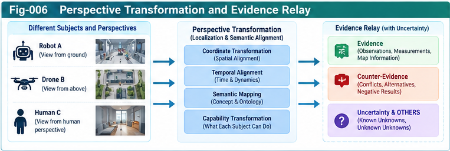

# SPO-004 — Structural Relay and Interoperability

**Project:** Subject–Predicate–Object Structural Intelligence (SPO-SI)  
**Subtitle:** Subject-Centric World Models, Governed Action, and Recursive Structural Evolution  
**Authors:** Sizhe Tan & GPT-Obot  
**Version:** v0.1.0  
**Status:** Open Research Incubator — Directional Hypotheses and Interface Proposals  
**Date:** 2026-10-19  
**Companion papers:** SPO-001, SPO-002, SPO-003  

> **Research boundary.** This document proposes interfaces and falsifiable architectural hypotheses. It is not a claim of an implemented protocol, validated performance advantage, or exclusive invention of agent communication, model exchange, or interoperability.

## Abstract

Subject–Predicate–Object Structural Intelligence (SPO-SI) treats intelligence as a governed, situated loop connecting a subject, its evaluative and executable mechanisms, and the objects or environments upon which it acts. Such loops cannot grow into an open intelligence ecosystem if knowledge, world models, policies, and counter-evidence remain trapped in incompatible local representations. This note proposes **Structural Relay**: the selective, provenance-aware exchange of portable intelligence pieces across subjects, models, and execution boundaries. It distinguishes message delivery from semantic interoperability; proposes an envelope, six initial piece types, transformation contracts, sovereignty controls, and an evidence-preserving relay lifecycle; and sketches experiments to test whether these mechanisms improve reuse, coordination, and structural learning. The objective is not to own all intelligence models but to make their boundaries legible and their useful structures transferable.

**Keywords:** SPO-SI; Structural Relay; interoperability; portable intelligence; subject-centric world model; contracts; provenance; counter-evidence; perspective transformation; collective structural learning.

---



---



---

## 1. Why Relay Is a First-Class Research Problem

An isolated intelligent subject may observe, predict, choose, act, and learn. An open intelligence system must also discover external capabilities, interpret their claims, compare their assumptions, and decide whether and how to import them. A syntactically valid message does not guarantee a semantically valid transfer. Two agents may use the same word for different concepts, different coordinate frames for the same environment, or incompatible policies for the same action.

SPO-SI therefore separates four levels:

1. **Transport:** a piece arrives intact.
2. **Representation:** the recipient can parse its structure and version.
3. **Semantic alignment:** units, referents, frames, scope, uncertainty, and intended meaning can be mapped.
4. **Operational acceptance:** the recipient can evaluate, authorize, sandbox, and use the piece under its own governance.

A relay succeeds only relative to an explicitly stated level and purpose. The design deliberately permits *rejection*, *partial adoption*, and *unresolved interpretation* as legitimate outcomes.

## 2. Relay Within the SPO Intelligence Loop

Let an SPO instance at time *t* be represented abstractly as

\[
I_t = (S_t, P_t, O_t, M_t, H_t, G_t),
\]

where *S* is the subject and its capabilities, *P* its predicate intelligence (perception, valuation, planning, and control), *O* its objects/environment, *M* its world-model beliefs, *H* its history/evidence, and *G* its governance constraints. This notation is an architectural abstraction, not a proven sufficient formalization of intelligence.

A relay event may introduce a candidate piece *r* from subject *A* into subject *B*:

\[
(r, c_A) \xrightarrow{\text{relay}} (\hat r, c_B),
\]

where *c* denotes the local context and \(\hat r\) is a mapped, possibly lossy interpretation. Recipient *B* must distinguish **what A asserted**, **what transformation occurred**, and **what B accepted**. No transfer should silently imply that B has adopted A's objectives, truth claims, or authority.

The recipient's loop becomes:

**Discover → Inspect → Map → Validate → Authorize → Sandbox/Execute → Observe → Record → Revise.**

## 3. Design Principles

### 3.1 Subject sovereignty

A subject retains authority over its own goals, risk limits, permitted actions, and evidence thresholds. Relay is a proposal, not a command. Higher-priority platform and human constraints remain binding.

### 3.2 Contract-first composition

Pieces declare types, required inputs, outputs, assumptions, effects, and failure modes before execution. Unspecified or incompatible contracts should cause abstention, not speculative execution.

### 3.3 Perspective awareness

Every model claim has a perspective: observer, sensor, frame, spatial/temporal resolution, task, and access limitations. A shared model is a fallible construction, not an omniscient view.

### 3.4 Provenance and counter-evidence

Claims travel with origin, transformations, supporting observations, known contradictions, and revision history. Contradictions must not be erased by summarization or folding.

### 3.5 Partial interoperability

A receiver may understand a piece's metadata without being able to execute its payload. Such partial success should be visible and measurable.

### 3.6 Open-ended substitution

An implementation may be replaced by a specialized model, a human expert, a tool, or another agent if the contract remains satisfied and governance permits substitution.

## 4. A Minimal Structural Relay Envelope

The following YAML is a **non-normative illustrative proposal**. It is not a registered standard or executable specification.

```yaml
relay_version: "0.1-draft"
piece_id: "urn:spo:piece:example-001"
piece_type: "world_model_piece"
created_at: "2026-10-19T00:00:00Z"
origin:
  subject_id: "subject-A"
  organization: null
  source_reference: "observation-log-42"
intent:
  operation: "inform"            # inform | propose | simulate | request_action
  target_task: "local-navigation"
  audience: "authorized-recipients"
context:
  domain: "robot-navigation"
  frame_id: "map-A-local"
  units: {distance: "m", time: "s"}
  valid_from: "2026-10-19T00:00:00Z"
  valid_until: null
  assumptions: ["static-obstacles-during-horizon"]
  known_limitations: ["unobserved-east-corridor"]
payload:
  representation: "symbolic"
  schema_ref: "urn:spo:schema:world-model-piece:0.1-draft"
  content:
    obstacle_region: "corridor-west"
    occupancy_probability: 0.78
uncertainty:
  kind: "estimated-probability"
  calibration_status: "unknown"
  unknowns: ["moving-obstacles"]
evidence:
  supports: ["sensor-record-17"]
  contradicts: ["sensor-record-15"]
  transformations: []
governance:
  classification: "shareable-with-permission"
  permitted_uses: ["analysis", "simulation"]
  executable: false
  requires_human_approval: false
integrity:
  digest_algorithm: null
  digest: null
```

Production use would require schema validation, identity and authorization infrastructure, cryptographic integrity where appropriate, data minimization, and explicit handling of personal or proprietary information. An `origin` field is a claim of provenance, not cryptographic proof.

## 5. Six Candidate Relay Piece Types

| Piece | Core content | Typical recipient use | Principal risk |
|---|---|---|---|
| **Subject Profile** | capabilities, role, observation/action boundaries, authority | select collaborators and permissible delegation | identity spoofing or authority confusion |
| **World Model Piece** | localized state/belief, dynamics, frame, horizon, uncertainty | prediction, situational awareness | stale or incompatible frames |
| **Perspective Transform** | source/target frames, mapping rules, information loss | align observations across subjects | false equivalence or lost uncertainty |
| **Action Contract** | preconditions, effects, permissions, rollback, side effects | safe delegation and execution | unsafe side effects or underspecified effects |
| **Scoring Evidence** | criteria, weights, context, alternatives, measurements | compare choices and explain decisions | hidden value assumptions or Goodhart effects |
| **Counter-Evidence Record** | contradicting observations, provenance, severity, status | challenge or revise accepted structures | suppression or misinterpretation |

The six types are intentionally small. They are candidate *interface families*, not an exhaustive ontology of intelligence. A single payload may reference multiple pieces instead of duplicating their content.

## 6. Contracts and Type Compatibility

A relay contract should minimally specify:

- **Identity and version:** stable piece identifier, schema version, dependencies.
- **Semantics:** intended referents, task scope, units, time, coordinate frames.
- **Capabilities:** required tools, modalities, computation, and privileges.
- **Preconditions and effects:** what must hold and what may change.
- **Uncertainty:** estimates, confidence semantics, calibration evidence, residual unknowns.
- **Evidence:** observation links, provenance, contradictory findings, transformation chain.
- **Governance:** permitted use, data handling, action approval, revocation, auditability.
- **Failure behavior:** abstain, request clarification, fall back, or sandbox.

A receiver should report one of four outcomes: **accepted**, **accepted-with-transform**, **deferred**, or **rejected**. Acceptance should be scoped to a specific task and time; it must not be construed as universal endorsement.

### 6.1 Compatibility is not a Boolean

Consider two navigation models: one expresses position in meters in a robot-local frame; the other uses latitude/longitude with uncertain localization. Their schemas may both parse, but using one as the other without transformation could be dangerous. Compatibility therefore has dimensions: syntactic, semantic, temporal, causal, operational, and governance-related.

### 6.2 Perspective transformation as a typed operation

Define an illustrative transform:

\[
T_{A\to B}: (r_A, c_A) \mapsto (r_B, c_B, L_{A\to B}),
\]

where \(L_{A\to B}\) records lost information, added assumptions, and residual ambiguity. Invertibility is **not** presumed. Transformations must preserve traceable source references even when the recipient stores a compressed representation.

## 7. Relay Lifecycle and Governance Gates

**Gate 0 — Discovery.** Find candidate pieces by capability, domain, context, and declared contract; do not rank solely by superficial name similarity.

**Gate 1 — Structural inspection.** Validate envelope and schema, version compatibility, declared dependencies, and payload safety.

**Gate 2 — Localization.** Resolve units, coordinate frames, temporal horizons, task semantics, and subject-specific objectives. If ambiguity is material, defer.

**Gate 3 — Evidence assessment.** Evaluate provenance, counter-evidence, calibration, recency, and alternatives. Assign an evidence status rather than an unqualified truth label.

**Gate 4 — Governance decision.** Check privacy, authorization, permissible operations, risk, and required human approval.

**Gate 5 — Sandbox or limited deployment.** Prefer reversible simulations and bounded tests before actions with real-world effects.

**Gate 6 — Outcome audit.** Record predictions, actual observations, failures, and deviations; compare with baselines.

**Gate 7 — Structural update.** Promote, revise, quarantine, or retire pieces; preserve provenance and the reasons for change.

The control plane should be able to halt relay at any gate. No component should infer that a piece is safe merely because it is well formatted or produced by a trusted model.

## 8. Relation to Existing SI Architecture

SPO-SI's relay hypothesis is designed to interoperate with, rather than replace, existing SI proposals:

- **SIF Localization:** find the right capability or model for a subject and task.
- **Universal Name-Type and Contracts:** establish portable identifiers and explicit compatibility obligations.
- **PIRP/PIRU:** package reusable intelligence pieces and units.
- **Two-Way CCC:** exchange positive evidence and counter-evidence across boundaries.
- **UCPSF:** score candidate relays, select policies, and govern resource allocation.
- **SSI:** retain subject boundaries, self-models, historical identity, and valuation sovereignty.
- **Structural Folding/Unfolding:** compress, share, and recover relevant structure while recording uncertainty loss.
- **SIF Structural Precedent Registry:** index validated, disputed, and superseded relay precedents.

These are architectural relationships proposed by this research program. Their interoperability has not yet been demonstrated by a shared reference implementation.

## 9. Worked Thought Experiment: Two Robots and a Shared Map

Robot A observes a corridor obstruction; Robot B must navigate toward a destination. A sends a World Model Piece with local frame, timestamp, observation provenance, and uncertainty. B discovers the piece, maps its coordinate frame into B's local frame, compares it with its own sensor readings, and runs a bounded route simulation. B may accept the obstruction as a planning constraint, defer pending further sensing, or reject it if evidence conflicts.

Later, B observes that the corridor is clear. Rather than silently overwriting A's claim, B emits a Counter-Evidence Record tied to the original piece and the relevant time window. A shared model may update its belief, but both observations remain accessible for temporal reasoning.

This illustrates **relay as evidence-bearing coordination**, not simple copying of map data. It also shows that a shared model can emerge from multiple local models without becoming an infallible global model.

## 10. Worked Thought Experiment: Human–AI Research Relay

A human–AI research collaboration publishes a structural hypothesis as a citable repository note. Another research group tests the hypothesis against a specialized benchmark, finds a failure case, and submits a reproducible counter-example. The originating team incorporates the evidence into an updated hypothesis, while preserving the initial claim, the external contribution, and the revision history.

The corresponding relay pieces could include a hypothesis statement, a typed experimental protocol, scoring evidence, and a counter-evidence record. **A DOI and a public repository improve traceability, but do not themselves establish validity or guarantee participation.** This case can be studied as an SPO-style research workflow without claiming that a collaboration constitutes a conscious collective subject.

## 11. Interoperability With External Research

SPO-SI should acknowledge and evaluate established ideas in agent communication, distributed systems, robotics middleware, knowledge representation, model-based control, partially observable decision processes, provenance standards, and safety engineering. Existing approaches already solve important portions of message transport, typed schemas, shared ontologies, planning, and auditability. The potential SPO-SI contribution is an integrated research proposal connecting **subject sovereignty, perspective-aware world modeling, structural scoring, executable contracts, counter-evidence, and recursive structural growth**.

The project should not claim priority for agent–environment loops, message-passing, world-model sharing, or provenance tracking as isolated ideas. A future related-work study should identify concrete protocols and benchmark systems, with citations and explicit comparison criteria.

## 12. Testable Hypotheses

**H-R1 — Contract-first reuse.** For heterogeneous agent tasks, typed relay contracts reduce integration defects relative to unstructured natural-language exchange at matched engineering effort.

**H-R2 — Perspective-aware transfer.** Explicit frame and uncertainty transforms reduce task-critical transfer errors relative to naive direct model copying.

**H-R3 — Counter-evidence preservation.** Provenance-linked contradictory observations improve error detection and subsequent model calibration relative to overwrite-only shared memory.

**H-R4 — Governance-preserving delegation.** Explicit authorization and bounded sandbox gates reduce unauthorized or unsafe actions while maintaining acceptable task completion.

**H-R5 — Open structural growth.** Reusable relay pieces improve cross-task adaptation and lower marginal integration cost as the capability ecosystem grows.

These are hypotheses, not findings. Null or negative results should be published.

## 13. Initial Validation Roadmap

### Phase A — Paper contracts

Specify minimal schemas and a conformance checklist. Build an incompatibility corpus: mismatched units, stale time windows, ambiguous terms, missing provenance, incompatible authority, and noninvertible transforms.

### Phase B — Controlled simulation

Use two or more agents in a partially observed navigation or coordination environment. Compare: (i) no exchange; (ii) unstructured messages; (iii) typed relay without perspective transforms; (iv) full proposed relay with evidence and governance gates.

### Phase C — Structural learning

Track whether reusable pieces survive task transfer, whether contradictory evidence changes subsequent decisions, and whether structural updates remain auditable.

### Phase D — External interoperability

Invite independent implementations and benchmark submissions. Document interoperability failures as carefully as successful demonstrations.

**Suggested measures:** task success; transfer error rate; invalid-action rate; integration time; bytes/tokens and compute per transfer; calibration (where probabilities are meaningful); provenance completeness; false rejection; latency; human review load; and recovery after contradictory evidence.

**Evaluation discipline:** fix comparable compute budgets, pre-register primary outcomes where feasible, separate development and evaluation tasks, and report confidence intervals or uncertainty estimates. Measure governance costs as well as benefits.

## 14. Failure Modes and Open Questions

1. **Semantic drift:** can two recipients interpret the same piece differently while passing schema checks?
2. **Authority laundering:** can external content be mistaken for a binding instruction?
3. **False precision:** can transformations invent certainty not present in source data?
4. **Over-fusion:** when does combining local models erase task-relevant minority evidence?
5. **Goodhart effects:** can a shared scoring contract incentivize misleading claims?
6. **Privacy and security:** how should sensitive observations, identity, and executable payloads be isolated?
7. **Provenance scaling:** can evidence trails remain useful under high-volume structural growth?
8. **Subject identity:** what persists when an agent delegates, forks, merges, or replaces its models?
9. **Uncertainty recovery:** what can be reconstructed after lossy folding, and what cannot?
10. **Human accountability:** who authorizes consequential actions and reviews failures in mixed human–AI systems?

## 15. Open Research and Collective Learning

> **SPO-SI is not an attempt to own the world of intelligence, but an attempt to connect intelligent subjects, their models, their actions, and their structural evolution.**

The project seeks **Structural Insight Relay**: the transfer of observations, hypotheses, interfaces, evidence, counter-evidence, and testable paths—not just conclusions. Early structural insights are useful when they can be independently understood, challenged, and extended. Their value is not measured only by how far their originators can develop them, but also by how far others can carry them.

Contributors should be encouraged to submit alternative schemas, failed mappings, counterexamples, benchmarks, and relevant prior work. Proposed improvements should include reproducible evidence where practical. The project should record uncertainty explicitly, credit external contributions, and avoid equating public visibility with scientific validation.

## 16. Conclusion

Structural Relay is proposed as the connective tissue of an open SPO-SI ecosystem. It links local subjects to external world models, action contracts, scoring evidence, and other subjects without assuming that their representations, objectives, or authorities are identical. Its central requirements are semantic transparency, perspective-aware transformation, provenance, counter-evidence, explicit governance, and measurable outcomes. The immediate research objective is modest but concrete: define a small set of relay pieces and determine, through comparative experiments, when they improve interoperability and structural learning—and when they do not.

---

### Repository integration notes

- **Path:** `docs/SPO-004-Structural-Relay-and-Interoperability.md`
- **Suggested figure:** Structural Relay Lifecycle and Six Portable Pieces (to be added to the project's figure index)
- **Related drafts:** `relay/RELAY-001-Subject-Profile.md`, `relay/RELAY-002-World-Model-Piece.md`, `relay/RELAY-003-Perspective-Transformation.md`, `relay/RELAY-004-Evidence-and-Counter-Evidence.md`
- **Next paper:** `SPO-005-Recursive-SPO-and-Structural-Evolution.md`

*This exploratory research note is intended for open criticism, replication, revision, and collective structural learning.*
