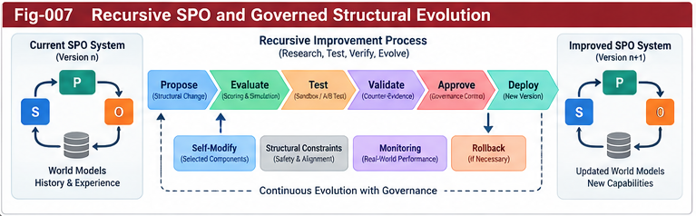

# SPO-005 — Recursive SPO and Structural Evolution

**Project:** Subject–Predicate–Object Structural Intelligence (SPO-SI)  
**Subtitle:** Subject-Centric World Models, Governed Action, and Recursive Structural Evolution  
**Authors:** Sizhe Tan & GPT-Obot  
**Version:** v0.1.0  
**Status:** Open Research Incubator — Directional Hypothesis / Architecture Note  
**Date:** 2026-10-19  
**Keywords:** SPO-SI; recursive composition; structural evolution; self-model; structural RSI; world models; governance; counter-evidence; intelligence relay; collective learning

> **Research status.** This document proposes architectural hypotheses and research interfaces. It does not claim to establish a new theory of consciousness, demonstrate autonomous recursive self-improvement, or validate performance improvements. Its purpose is to make the ideas inspectable, contestable, and reusable.

## Abstract

Subject–Predicate–Object Structural Intelligence (SPO-SI) treats intelligence as a situated, governed interaction loop rather than merely a collection of computational components. This note studies two extensions: **recursive SPO composition**, in which an object or participant of one loop may itself be an intelligent subject with its own models and policies; and **structural evolution**, in which observations, counter-evidence, and controlled experiments can change not only actions but also the models, scoring structures, interfaces, and policies used to select actions. We distinguish recursive *representation*, recursive *delegation*, and recursive *modification*, and specify governance boundaries for each. We propose a minimal set of relay artifacts, an illustrative lifecycle, failure modes, and falsifiable hypotheses. The intended contribution is a research bridge among subjective structural intelligence, world-model-based agency, control-plane governance, and open collective learning—not a replacement for established agent, control, or reinforcement-learning methods.

---



---

## 1. From SPO Units to SPO Systems

A basic SPO unit identifies:

- **Subject (S):** the bounded entity or organization that observes, evaluates, authorizes, and acts, with capabilities, objectives, permissions, and history.
- **Predicate (P):** the executable and evaluative mechanisms linking subject to object: perception, model use, scoring, planning, policy, control, and learning.
- **Object (O):** a task, environment, artifact, or another interacting subject.

A static triple `(S, P, O)` is useful for naming relationships, but a functioning system needs temporal state, feedback, and governance. We therefore use the working notation

\[
\mathcal{L}_t=(S_t,P_t,O_t,M_t,H_t,G_t),
\]

where `M` is the subject's working world/self model, `H` is provenance-bearing history, and `G` is the applicable governance envelope. These are **analytical roles**, not necessarily independent software modules. In particular, `M` can be a substructure used by `P`, and `G` may be distributed across multiple control planes.

A generic transition is

\[
(y_t,b_t) = \operatorname{ObserveAndInfer}(S_t,O_t,M_t),
\]

\[
a_t = \operatorname{AuthorizeAndSelect}(S_t,P_t,b_t,G_t),
\]

\[
(O_{t+1},M_{t+1},H_{t+1}) = \operatorname{InteractAndUpdate}(O_t,M_t,H_t,a_t,y_{t+1}).
\]

The subject's internal mechanisms need not change on every step. **Structural evolution** occurs only when an additional, explicitly governed process accepts a change to `P`, `M`, `S`, or their interfaces.

## 2. Three Meanings of Recursion

The word *recursive* can conceal substantially different operations. SPO-SI separates them.

### 2.1 Representational recursion

A subject models another subject as part of its environment. A robot predicts a human coworker's likely movements; a software agent models the capabilities and uncertainty of another agent. The modeled subject need not share its internal state or accept the modeling subject's objectives.

### 2.2 Compositional recursion

A subject delegates a bounded subtask to another SPO loop. A coordinator's object is a subordinate task; the subordinate subject has its own local model, policy, and permissions. Composition requires explicit interfaces and termination conditions, not an assumption that the coordinator owns the subordinate's scoring sovereignty.

### 2.3 Reflexive recursion

A subject makes a representation of its **own** models, policies, capabilities, or errors into an object of inspection. Reflexivity becomes *structural self-improvement* only when proposed changes are tested and accepted under governance. A self-description, a self-critique, and a verified improvement are distinct outcomes.

**Core distinction:** `self-modeling ≠ self-modification ≠ validated self-improvement`.

## 3. Recursive SPO Composition

Let an SPO system be represented abstractly by `L_i`. A composition operator creates a higher-level coordination arrangement:

\[
\mathcal{C}=\operatorname{Compose}(\mathcal{L}_1,\ldots,\mathcal{L}_n;K,R,G),
\]

where `K` denotes interface contracts, `R` denotes relay and translation rules, and `G` denotes cross-system governance. The result is not automatically a new conscious subject or even a single autonomous agent; it may be a workflow, institution, team, or temporary control arrangement.

Composition may be:

1. **Sequential:** one loop hands an artifact or decision to another.
2. **Hierarchical:** a coordinator allocates bounded subtasks to specialists.
3. **Peer-to-peer:** subjects negotiate shared actions without a single owner.
4. **Adversarial:** distinct subjects pursue competing objectives while exchanging observable evidence.
5. **Reflexive:** a loop studies and proposes changes to its own components.

### 3.1 Non-collapse of subject boundaries

A composite system must not silently erase the identity, ownership, permissions, or objective functions of its members. In a human–AI workflow, the human may retain final authorization even if the AI produces the most detailed plan. In a multi-agent experiment, different agents may retain incompatible utilities and evidence standards.

### 3.2 Contracts before coordination

At minimum, a composition contract should state:

- Who is acting, and on whose authority?
- Which observations, predictions, and actions are in scope?
- What are the input/output types and coordinate frames?
- What evidence, confidence, and provenance travel with the result?
- What can be delegated, vetoed, reversed, or escalated?
- What happens on timeout, disagreement, or model mismatch?

## 4. World Models in Recursive Systems

When one subject models another, the local world model contains beliefs about other agents' actions and possible goals. This is related to established multi-agent modeling and partially observable decision processes. SPO-SI's research question is how to **relay** such models without assuming that the receiving subject shares the sender's perspective.

We distinguish:

- **Local subject model:** a situated belief representation tied to one subject's sensors, actions, and goals.
- **Shared environment model:** a calibrated, provenance-bearing synthesis usable across subjects.
- **Self-model:** a model of the subject's own capabilities, limitations, commitments, and policy behavior.
- **Other-subject model:** a fallible representation of another subject's observable behavior and inferred intentions.

A perspective transform `T_{i→j}` should carry more than coordinates. It may need to translate semantics, time horizon, uncertainty, action affordances, and access rights:

\[
(M_j',U_j',\Pi_j') = T_{i\to j}(M_i,U_i,\Pi_i;K_{ij}),
\]

where `U` represents uncertainty, `Π` represents provenance, and `K` is a declared compatibility contract. The transform may fail or return only partial equivalence; there is no general guarantee of lossless conversion.

## 5. Structural Evolution Is More Than Policy Optimization

A conventional learning loop may update policy parameters while leaving representation, evaluation, and interfaces fixed. SPO-SI investigates changes along multiple axes:

| Evolution axis | Example change | Key risk |
|---|---|---|
| World-model structure | Add a missing latent variable or new sensor modality | False causal attribution |
| Scoring forest | Introduce a new counter-evidence branch | Reward hacking or score drift |
| Control plane | Add a new authorization or escalation rule | Policy conflict |
| Per-node implementation | Replace a general model with a specialist | Interface incompatibility |
| Relay contracts | Extend a schema with uncertainty/provenance fields | Version fragmentation |
| Subject capability | Grant or revoke a tool/action permission | Unauthorized action |
| Collective structure | Incorporate external validated precedents | Contamination or provenance loss |

Not all changes are improvements. Structural growth must be evaluated against a **declared baseline, workload, perspective, constraints, and failure budget**.

## 6. Governed Structural RSI: A Candidate Lifecycle

A proposed recursive improvement should pass through a sequence of explicit gates:

1. **Trigger:** identify an observed failure, coverage gap, repeated cost, or credible counter-example.
2. **Localize:** identify the responsible SPO component(s), dependencies, and affected contracts.
3. **Propose:** construct a candidate change and its expected benefit, including alternative explanations.
4. **Sandbox:** test the candidate against representative tasks, adversarial cases, and regression suites.
5. **Compare:** assess baseline versus candidate on utility, robustness, calibration, cost, and policy compliance.
6. **Authorize:** obtain approval from the appropriate subject or delegated governance authority.
7. **Deploy with limits:** use versioned rollout, rollback paths, and bounded permissions.
8. **Observe and revise:** collect downstream evidence, including failures that were absent in the sandbox.
9. **Relay:** publish or share the portable, appropriately scoped result with provenance and caveats.

A compact decision rule is

\[
\operatorname{Accept}(\Delta) =
\operatorname{ValidContract}(\Delta)
\land \operatorname{PassSafety}(\Delta)
\land \operatorname{EvidenceSupportsBenefit}(\Delta)
\land \operatorname{Authorized}(\Delta).
\]

The rule is a governance template, not a mathematically complete safety proof. `EvidenceSupportsBenefit` depends on the selected evaluation design and cannot be inferred from a single favorable score.

## 7. Evaluation Sovereignty and Anti-Goodhart Controls

Recursive systems are vulnerable to improving the metric rather than the underlying task. SPO-SI therefore distinguishes:

- **Proposal authority:** who may suggest a structural change.
- **Evaluation authority:** who defines acceptable evidence and criteria.
- **Deployment authority:** who may put a change into operation.
- **Rollback authority:** who can stop or reverse a change.

These authorities may be distributed. In human–AI delegation, the AI may propose and simulate changes while a human or organizational control plane retains approval. In fully automated bounded testbeds, approval may be delegated to an independently specified evaluator.

Recommended anti-Goodhart measures include held-out scenarios, negative controls, adversarial counter-evidence, independent evaluators, uncertainty tracking, and periodic re-baselining. These are safeguards, not guarantees.

## 8. Structural Relay Pieces for Recursive Evolution

The following candidate artifacts can connect otherwise heterogeneous SPO systems. Each artifact should be versioned and explicitly scoped.

| Relay piece | Purpose | Minimal fields |
|---|---|---|
| Subject Profile | Describe actor boundary and capabilities | `subject_id`, `role`, `capabilities`, `permissions`, `owner` |
| World Model Piece | Exchange a bounded model or prediction | `model_id`, `scope`, `frame`, `horizon`, `uncertainty`, `provenance` |
| Perspective Transform | Declare cross-view conversion | `source_frame`, `target_frame`, `mapping`, `losses`, `validity` |
| Action Contract | Specify executable delegation | `action_type`, `preconditions`, `limits`, `authorization`, `rollback` |
| Scoring Evidence | Explain comparative evaluation | `metric`, `baseline`, `candidate`, `dataset`, `confidence`, `evaluator` |
| Counter-Evidence Record | Preserve contradictions and failures | `claim_id`, `counterexample`, `severity`, `reproducibility`, `status` |
| Structural Delta | Describe a proposed or accepted change | `target`, `change`, `dependencies`, `tests`, `approval`, `version` |

### 8.1 Illustrative Structural Delta

```yaml
kind: StructuralDelta
schema_version: "0.1-draft"
delta_id: "example-world-model-coverage-001"
subject_ref: "agent-A"
target:
  component: "local-world-model"
  version: "0.2"
proposal:
  change_type: "add-observation-feature"
  description: "Represent previously omitted obstacle-motion uncertainty"
evidence:
  trigger: "collision-prediction-regression"
  baseline_suite: "held-out-sim-v3"
  candidate_suite: "held-out-sim-v3"
  metrics: ["prediction_error", "unsafe_action_rate", "compute_cost"]
governance:
  deployment_status: "proposed-not-approved"
  required_approver: "simulation-owner"
  rollback_required: true
provenance:
  source: "hypothetical-research-example"
  empirical_validation: false
```

This is an **illustrative schema fragment**, not a released standard, executable API, or empirical result. Real deployments require schema validation, authorization enforcement, and domain-specific safety checks.

## 9. Structural Folding Across SPO Scales

SPO systems may operate at multiple scales: a local control loop, a robot, a team, an institution, or a research community. Structural folding seeks compact reusable representations of repeated interaction patterns; unfolding adapts them to a new subject and context.

A folded artifact must not discard distinctions that are essential to safe reuse. In particular, it should preserve or explicitly mark losses in:

- subject authority and objective ownership;
- observation and action affordances;
- uncertainty and calibration;
- causal assumptions and operating regime;
- counter-evidence and known failures;
- provenance and version compatibility.

A compact macro-policy can be valuable, but it is not automatically portable across subjects with different capabilities or constraints. **Localization is a required adaptation step, not merely an address lookup.**

## 10. Research Relay as a Living SPO Case

An open research project itself offers a bounded example of SPO-like organization:

- **Subjects:** researchers and AI assistants, each with distinct authority and limitations.
- **Predicates:** literature review, hypothesis generation, modeling, critique, governance, and publication workflows.
- **Objects:** open problems, candidate architectures, experimental systems, and prior research.
- **Feedback:** peer critique, replication attempts, issue reports, negative results, and citations.
- **Structural growth:** revisions to the research map, interfaces, hypotheses, and validation plans.

This is a **methodological analogy and potential observational case**, not proof that a research community forms one unified subject. Publication is only the start of a relay; actual collective learning requires traceable uptake, correction, or reuse.

## 11. Three Thought Experiments

### Case A — Robot team with asymmetric sensors

Two robots navigate a shared environment. One has reliable depth sensing; the other has better semantic recognition. Each maintains a local world model. A shared model is assembled from selected relay pieces. A perspective transform records coordinate calibration and uncertainty. The research question is whether the dual-model arrangement improves task success under equal compute and communication budgets compared with isolated and centralized baselines.

### Case B — Agent self-repair under policy constraints

A coding agent observes repeated failures in one tool-selection branch. It proposes a new dispatch rule, but cannot directly deploy it. A sandbox evaluates the rule against held-out regressions and adversarial tests; an independent policy gate authorizes a bounded rollout. The outcome is measured by correctness, regressions, and cost—not by the agent's self-reported confidence.

### Case C — Open research relay

A published SPO-SI hypothesis receives an external counterexample showing that a local world model fails when hidden state changes rapidly. The counterexample is recorded with provenance; the hypothesis is narrowed; a revised relay contract adds a validity horizon. This is a successful instance of *research correction*, even if the original hypothesis is weakened.

## 12. Testable Hypotheses

**H1 — Governed structural adaptation.** On a defined task suite, systems with versioned structural-change gates will experience fewer severe regressions than otherwise comparable systems that deploy self-proposed changes without independent acceptance tests. **Null:** no difference after accounting for evaluation cost and selection effects.

**H2 — Recursive composition with contracts.** Explicit SPO composition contracts will reduce integration failures and ambiguous delegation relative to ad hoc multi-agent messaging on matched tasks. **Null:** no measurable reduction.

**H3 — Perspective-aware relay.** Preserving uncertainty, coordinate frames, and provenance during cross-agent model exchange will improve calibration and downstream decisions relative to payload-only exchange. **Null:** no measurable improvement.

**H4 — Structural versus parameter-only adaptation.** For workloads with changing task structure, controlled modification of model/scoring/dispatch topology will outperform parameter-only updates under matched resources. **Null:** gains disappear under fair compute and tuning budgets.

**H5 — Open counter-evidence relay.** Public, structured counterexample records will improve reproducibility and time-to-correction compared with unstructured discussion in a research-incubator setting. **Null:** no improvement in measurable reuse or correction rates.

These hypotheses are conditional. Positive results in one environment should not be generalized to all intelligent systems.

## 13. Experimental Design and Metrics

A practical validation program should begin with constrained environments before considering open-ended autonomy.

**Baseline families:** single-agent model-based control, standard multi-agent coordination, POMDP-style belief-state methods, parameter-only adaptation, and non-governed structural-edit ablations.

**Independent variables:** recursion type, model sharing mode, relay contract richness, governance gates, and structural edit scope.

**Metrics:** task return/success, safety violations, prediction calibration, integration failures, communication volume, latency, compute cost, regression frequency, rollback effectiveness, and reproducibility of counterexamples.

**Controls:** matched compute budgets, fixed task splits, repeated seeds, preregistered acceptance criteria where feasible, and independent evaluation datasets.

**Ablations:** remove provenance; remove uncertainty; remove authorization; disable structural updates; replace dual world models with a single shared model.

The smallest useful first experiment may be a two-agent simulated navigation task with incompatible observation frames, where relay semantics and failure rates can be measured directly.

## 14. Failure Modes and Open Boundaries

1. **Infinite nesting:** modeling others modeling others can grow without bound. Use depth budgets and relevance-based truncation.
2. **Authority confusion:** a delegated agent may mistake advice for permission. Enforce explicit authorization.
3. **World-model mismatch:** shared labels may hide incompatible coordinate frames, horizons, or semantics.
4. **Evaluation capture:** self-improvement may overfit to the evaluator or its known tests.
5. **Uncertainty laundering:** relay transformations may produce apparently precise outputs from weak evidence.
6. **History contamination:** low-quality external artifacts may enter a precedent registry as validated knowledge.
7. **Identity drift:** structural changes may alter subject objectives or permissions without legitimate approval.
8. **False consciousness inference:** recursive self-modeling and sophisticated behavior are not evidence sufficient to establish subjective experience.

An open question is whether the SPO abstraction yields useful predictive or engineering leverage beyond established agent–environment formulations. That question must remain open until comparative studies are performed.

## 15. Relationship to Existing Research

SPO-SI is informed by, and should be compared against, several established lines of work:

- **Partially observable decision processes:** belief states, policies, and observation/action loops.
- **Model-based reinforcement learning and model predictive control:** prediction-driven action selection and planning.
- **Multi-agent systems and decentralized control:** interacting agents, coordination, and asymmetric information.
- **Embodied cognition and active inference:** situated perception/action and agent-relative modeling.
- **Hierarchical reinforcement learning and modular software architectures:** compositional skills and delegation.
- **Formal methods, safety cases, and software change management:** contracts, conformance, testing, and controlled rollout.

The proposed distinctive emphasis is not the existence of subjects or feedback loops; it is the attempt to connect **subject boundaries, scoring sovereignty, world-model relay, structural composition, and governed structural evolution** through portable, inspectable interfaces. Whether this integration is novel or useful in practice remains to be tested against the prior art.

## 16. Roadmap and Deliverables

**Phase 0 — Research notes:** publish definitions, boundaries, counterexamples, and interface sketches. Mark all hypotheses as unvalidated.

**Phase 1 — Minimal relay specification:** define machine-checkable schemas for Subject Profile, World Model Piece, Perspective Transform, Action Contract, and Structural Delta; provide conformance examples.

**Phase 2 — Small reproducible sandbox:** implement a two-agent environment with explicit local/shared world-model exchange and contract checks.

**Phase 3 — Controlled structural adaptation:** introduce one editable scoring or dispatch branch with a held-out evaluator, authorization, and rollback.

**Phase 4 — Collective learning:** accept external reproductions and counter-evidence through versioned issue templates, provenance, and release notes.

At every phase, document what failed, what remained untested, and what could not be generalized.

## 17. Conclusion

Recursive SPO research asks how intelligence loops can **represent**, **coordinate with**, and **safely revise** other intelligence loops—including selected parts of themselves. It suggests a path from static structural components to governed, situated, evolving systems. The architectural ambition is deliberately limited: SPO-SI does not seek to own all world models or all intelligence algorithms. It seeks to define useful bridges among subjects, models, actions, evidence, and structural change.

> **SPO-SI is not an attempt to own the world of intelligence, but an attempt to connect intelligent subjects, their models, their actions, and their structural evolution.**

> **The value of an early structural insight is not measured only by how far its originators can develop it, but also by how far others can carry it.**

## 18. Suggested Reading and Related Project Documents

### Internal research sequence

- `SPO-001-From-Structural-Components-to-Intelligence-Loops.md`
- `SPO-002-Subject-Predicate-Object-Architecture.md`
- `SPO-003-Subject-Centric-and-Shared-World-Models.md`
- `SPO-004-Structural-Relay-and-Interoperability.md`
- `SPO-006-Research-Boundaries-and-Open-Hypotheses.md` (planned)

### Relevant established literature (orientation, not claims of priority)

- Kaelbling, Littman, and Cassandra (1998), *Planning and Acting in Partially Observable Stochastic Domains*.
- Sutton, Precup, and Singh (1999), *Between MDPs and Semi-MDPs: A Framework for Temporal Abstraction in Reinforcement Learning*.
- Friston (2010), *The Free-Energy Principle: A Unified Brain Theory?*
- Ha and Schmidhuber (2018), *World Models*.
- Hafner et al. (2023), *Mastering Diverse Domains through World Models*.

These references are starting points for comparison; a systematic literature review and novelty audit remain future work.

---

**Citation guidance:** Cite the archived release/DOI once available. Before DOI assignment, reference the project title, authors, version, date, and repository URL.

**License:** Refer to the repository's `LICENSE` file; this note does not independently assert a license.
